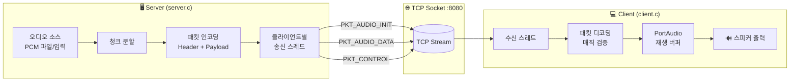
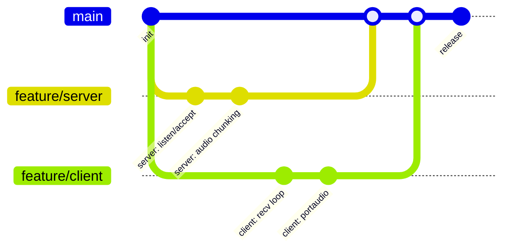

<div align="center">

# 🎧 Music Real-Time Streaming

**TCP 소켓 위에 직접 설계한 바이너리 프로토콜로 실시간 음악을 스트리밍하는 C 프로젝트**

서버가 PCM 오디오를 청크 단위로 밀어주고, 클라이언트가 이를 받아 **PortAudio**로 즉시 재생합니다.


</div>

---

## 📖 목차

- [프로젝트 소개](#-프로젝트-소개)
- [주요 기능](#-주요-기능)
- [시스템 아키텍처](#-시스템-아키텍처)
- [패킷 프로토콜](#-패킷-프로토콜)
- [프로젝트 구조](#-프로젝트-구조)
- [빌드 및 실행](#-빌드-및-실행)
- [팀 구성 및 역할](#-팀-구성-및-역할)
- [개발 워크플로우](#-개발-워크플로우)
- [트러블슈팅](#-트러블슈팅)

---

## 🎵 프로젝트 소개

> **"음악을 실시간으로, 끊김 없이."**

일반적인 파일 다운로드 방식이 아니라, **TCP 스트림 위에서 오디오를 연속적으로 전송**하여
클라이언트가 수신과 동시에 재생(streaming)할 수 있도록 구현한 프로젝트입니다.

- 🎼 **PCM 오디오**를 일정 크기의 청크로 분할 전송
- 🧩 **자체 설계 바이너리 프로토콜** (`protocol.h`)로 메타데이터 + 오디오 + 제어 메시지 통합
- ⚡ **멀티스레드** 서버로 다중 클라이언트 대응
- 🔊 클라이언트는 **PortAudio** 콜백 기반으로 저지연 재생

---

## ✨ 주요 기능

| 구분 | 기능 | 설명 |
| :---: | :--- | :--- |
| 🖥️ | **다중 클라이언트 처리** | `pthread` 기반으로 클라이언트별 스레드 할당 |
| 📦 | **오디오 메타데이터 교환** | 샘플레이트 / 채널 수 / 비트 깊이를 `PKT_AUDIO_INIT`로 사전 협상 |
| 🎚️ | **청크 스트리밍** | `PKT_AUDIO_DATA`로 PCM 데이터를 연속 전송 |
| ⏯️ | **재생 제어** | `PKT_CONTROL`로 PLAY / PAUSE 등 제어 신호 전달 |
| 🕒 | **타임스탬프 동기화** | 패킷 헤더의 `timestamp_ms`로 재생 타이밍 관리 |
| 🛡️ | **패킷 무결성 검증** | `PACKET_MAGIC`(`'SYNC'`)으로 유효 패킷 판별 |

---

## 🏗️ 시스템 아키텍처



**동작 흐름**

1. 클라이언트가 서버(`:8080`)에 TCP 연결을 맺습니다.
2. 서버가 `PKT_AUDIO_INIT`으로 오디오 포맷(샘플레이트/채널/비트)을 전송합니다.
3. 서버가 `PKT_AUDIO_DATA` 청크를 연속 전송하고, 클라이언트는 수신 즉시 재생합니다.
4. 필요 시 `PKT_CONTROL`로 재생 상태를 제어합니다.

---

## 📦 패킷 프로토콜

모든 패킷은 **1바이트 패딩 없이 직렬화**됩니다 (`#pragma pack(push, 1)`).

### PacketHeader (고정 18 bytes)

| 필드 | 타입 | 크기 | 설명 |
| :--- | :--- | :---: | :--- |
| `magic` | `uint32_t` | 4 B | 패킷 검증용 매직 넘버 (`0x53594E43` = `'SYNC'`) |
| `type` | `uint16_t` | 2 B | 패킷 타입 (아래 표 참고) |
| `payload_len` | `uint32_t` | 4 B | 뒤따르는 페이로드 바이트 크기 |
| `timestamp_ms` | `uint64_t` | 8 B | 서버 기준 타임스탬프 (ms) |

### 패킷 타입

| 상수 | 값 | 설명 |
| :--- | :---: | :--- |
| `PKT_AUDIO_INIT` | `1` | 오디오 메타데이터 (샘플레이트, 채널 등) |
| `PKT_AUDIO_DATA` | `2` | 실제 PCM 오디오 청크 |
| `PKT_CONTROL` | `3` | PLAY / PAUSE 등 제어 명령 |

### AudioMetaPayload (고정 8 bytes)

| 필드 | 타입 | 크기 | 예시 |
| :--- | :--- | :---: | :--- |
| `sample_rate` | `uint32_t` | 4 B | `44100` |
| `channels` | `uint16_t` | 2 B | `2` (스테레오) |
| `bits_per_sample` | `uint16_t` | 2 B | `16` (S16LE) |

> ⚠️ **`include/protocol.h`는 서버·클라이언트 공용 계약서입니다. 임의 수정 금지!**
> 변경이 필요하면 반드시 양쪽 담당자가 합의 후 진행합니다.

---

## 📁 프로젝트 구조

```text
Music-Real-Time-Streaming/
├── Makefile              # 빌드 스크립트 (server / client 타깃)
├── README.md
├── include/
│   └── protocol.h        # 🔒 공용 패킷 프로토콜 정의 (수정 금지)
├── server/
│   ├── server.c          # 🖥️ 서버 진입점
│   └── lib/
│       ├── server_runtime.c/.h # 송신, 접속, 콘솔 제어
│       └── wav_file.c/.h      # WAV 파일 파싱
├── client/
│   ├── client.c          # 💻 클라이언트 진입점
│   └── lib/
│       ├── audio_buffer.c/.h # 수신 캐시, 탐색, 배속
│       ├── audio_player.c/.h # PortAudio 재생
│       ├── control.h
│       ├── net_util.c/.h
│       └── packet_handler.c/.h
└── bin/                  # 빌드 산출물 (gitignore)
    ├── server
    └── client
```

---

## 🔨 빌드 및 실행

### 사전 요구사항

```bash
# Ubuntu / Debian 기준
sudo apt-get update
sudo apt-get install -y build-essential libportaudio2 portaudio19-dev
```

| 도구 | 용도 |
| :--- | :--- |
| `gcc` | C 컴파일러 |
| `make` | 빌드 자동화 |
| `portaudio19-dev` | 클라이언트 오디오 출력 |
| `pthread` | 서버 멀티스레딩 (glibc 내장) |

### 빌드

```bash
# 전체 빌드
make

# 개별 빌드
make server
make client
make test

# 정리
make clean
```

### 실행

```bash
# 1) 서버 컴퓨터에서 WAV 파일을 지정해 실행 (기본 포트 8080)
./bin/server /path/to/music.wav

# 2) 클라이언트 컴퓨터에서 서버의 사설 IPv4 주소로 접속
./bin/client 192.168.0.10 8080
```

> `192.168.0.10`은 예시입니다. 서버 컴퓨터에서 `ip addr`(Linux) 또는
> `ipconfig`(Windows)로 Wi-Fi 어댑터의 IPv4 주소를 확인해 사용하세요.
> 클라이언트의 기본 주소 `127.0.0.1`은 클라이언트 자기 자신이므로,
> 다른 컴퓨터의 서버에 연결할 때는 서버의 사설 IPv4 주소를 전달해야 합니다.
> 방화벽에서 서버 포트(기본 TCP 8080)의 인바운드 연결도 허용하세요.

클라이언트 터미널 조작:

- `←` / `→`: 이미 수신된 구간에서 5초씩 이동
- `+` / `-`: 0.25x 단위로 0.5x~4.0x 배속 조절 (음높이도 함께 변경)
- `Space`: 일시정지/재개, `q`: 종료
- 진행 바에서 `=`는 재생한 구간, `-`는 수신된 구간입니다. 스트림 특성상 아직 수신되지 않은 구간으로는 이동할 수 없습니다.

---

## 👥 팀 구성 및 역할

**2인 1조** — 서버와 클라이언트를 각각 전담하여 개발했습니다.

<table>
<tr>
<td width="50%" valign="top">

### 🖥️ Server 담당

**브랜치:** `feature/server`

- TCP 리스닝 소켓 및 `accept` 루프 구현
- `pthread` 기반 클라이언트별 송신 스레드
- 오디오 파일 → PCM 청크 분할 로직
- `PacketHeader` 인코딩 및 전송 스케줄링
- `PKT_AUDIO_INIT` 메타데이터 협상
- 타임스탬프 기반 전송 타이밍 제어

</td>
<td width="50%" valign="top">

### 💻 Client 담당

**브랜치:** `feature/client`

- 서버 연결 및 수신 루프 구현
- `PacketHeader` 파싱 및 `PACKET_MAGIC` 검증
- `PKT_AUDIO_INIT` 수신 → PortAudio 스트림 초기화
- PortAudio 콜백 기반 저지연 재생
- `PKT_CONTROL` 처리 (PLAY / PAUSE)
- 버퍼 언더런 방지 및 재생 안정화

</td>
</tr>
</table>

### 🤝 공통 (Contract First)

- `include/protocol.h` 패킷 규격 **합의 후 동결**
- `Makefile` 빌드 환경 공유
- 통합 테스트 및 디버깅

---

## 🔀 개발 워크플로우



| 브랜치 | 담당 | 설명 |
| :--- | :---: | :--- |
| `main` | 공통 | 통합 및 릴리스 (직접 push 금지) |
| `feature/server` | Server | 서버 기능 개발 |
| `feature/client` | Client | 클라이언트 기능 개발 |

**커밋 컨벤션**

```text
[MAIN]    공용 파일 변경 (protocol.h, Makefile 등)
[SERVER]  서버 관련 변경
[CLIENT]  클라이언트 관련 변경
```

---

## 🧯 트러블슈팅

<details>
<summary><b>PortAudio 초기화 실패 (<code>Pa_Initialize</code> 오류)</b></summary>

- `portaudio19-dev` 설치 여부 확인
- 오디오 장치 접근 권한 확인 (`alsa`, `pulseaudio` 실행 상태)
- 헤드리스 환경에서는 실제 출력 장치가 없어 실패할 수 있습니다.

</details>

<details>
<summary><b>패킷이 깨지거나 파싱이 안 됨</b></summary>

- `protocol.h`의 `#pragma pack(push, 1)` 구조체 정렬이 양쪽에서 동일한지 확인
- `magic` 값(`0x53594E43`) 검증 로직 확인
- 엔디안 차이가 있는 환경이라면 바이트 순서 확인

</details>

<details>
<summary><b>재생이 끊기거나 지직거림</b></summary>

- 네트워크 지연으로 버퍼 언더런 발생 → 클라이언트 재생 버퍼 크기 확대
- 청크 크기 조정 (너무 작으면 오버헤드, 너무 크면 지연 증가)

</details>

---

<div align="center">

**🎶 Made with C, TCP & a lot of ☕**

</div>

